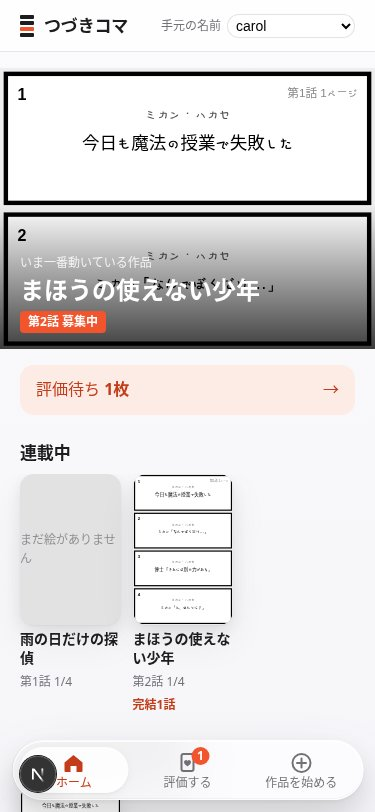
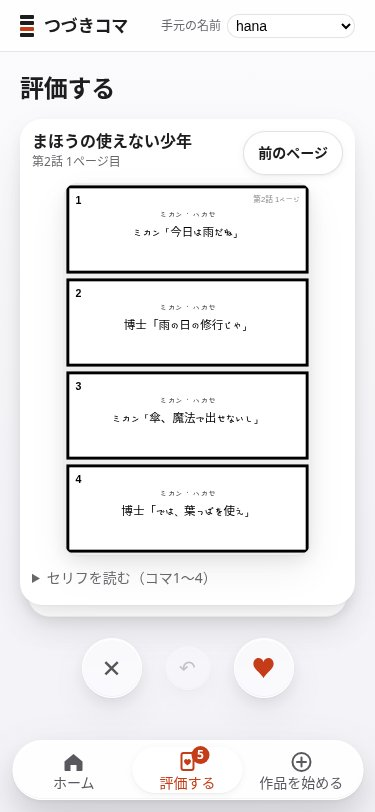
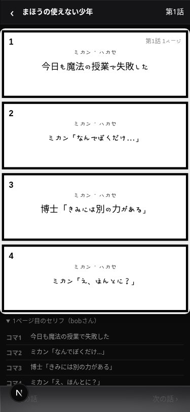
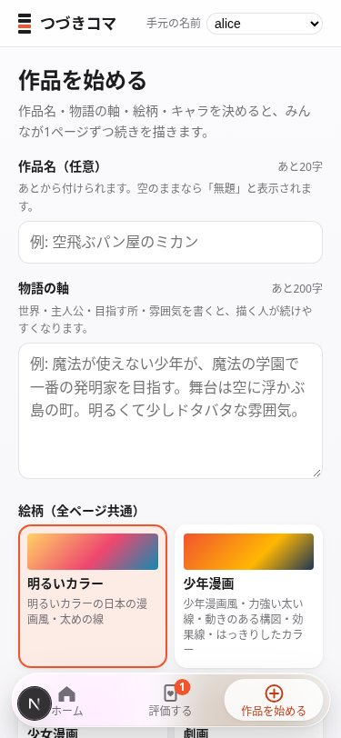
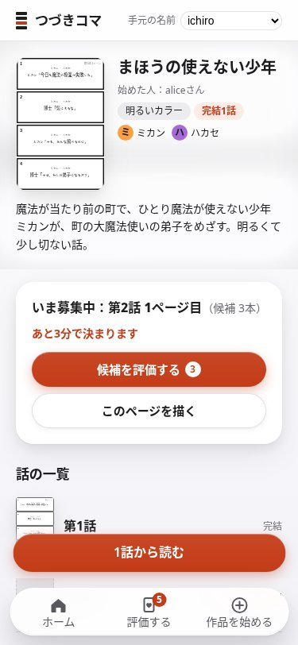
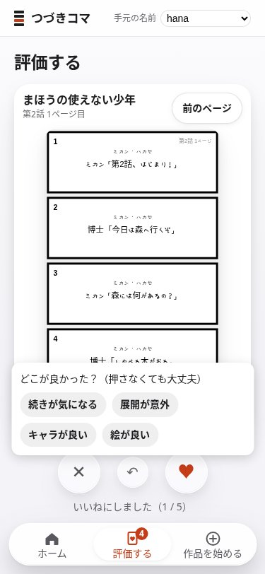
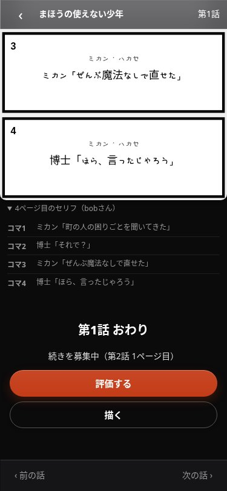
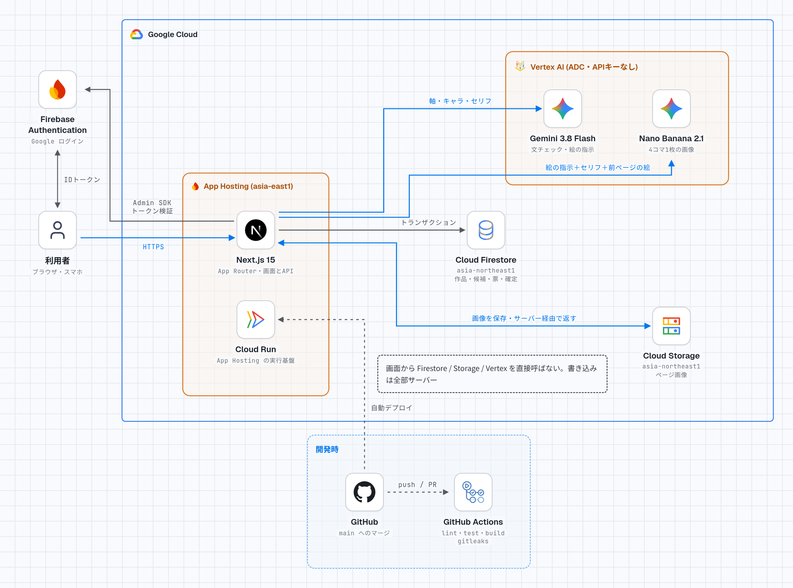
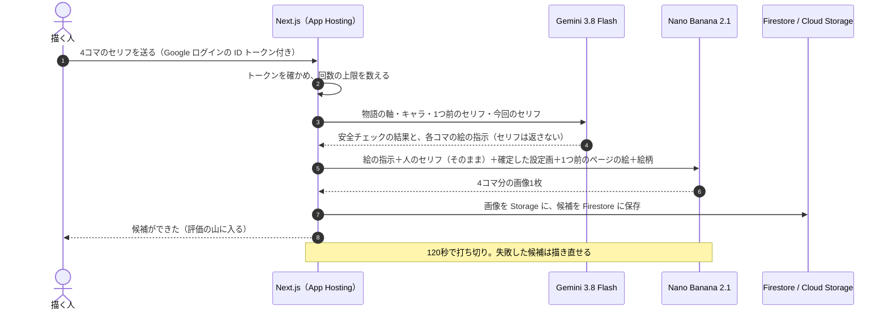

# つづきコマ

**話は人が書き、絵は AI が描く。みんなで1ページずつ続ける連載漫画の Web アプリ。**

本番 URL → https://devfest-4koma--project-bd07690e-65d2-4420-910.asia-east1.hosted.app

DevFest GDGoC Japan Hackathon 2026 ／ チーム 赤味噌レンジャー（[@H4aruki](https://github.com/H4aruki)・[@Maaa2005](https://github.com/Maaa2005)）

 

<!-- 下の3枚は開発用の生成器（GENERATOR=fake。画像 AI を呼ばない）で撮った画面。
     本番で Vertex AI が描いたページを撮れたら、docs/assets/ に置いて差し替える -->

左から ホーム／スワイプで評価／1話を通して読む。画面は開発用の生成器で撮影（絵の枠は AI を呼ばない仮の画像）

---

## 30秒で分かること

| 問い | 答え |
|---|---|
| 誰の困りごとか | 話を考えるのは好きだが、絵が描けない人。思いついた展開を漫画にして読んでもらう手段がない |
| 何をするか | 1人が書くのは1ページ分（4コマのセリフ）だけ。AI がそれを漫画の1ページに描く。同じページに集まった候補をみんながスワイプで評価し、一番いいねが多い候補がそのページに決まる |
| 何が新しいか | AI にセリフや筋を書かせない。セリフの正本は人の文だけで、AI の担当は絵と安全チェックに限る。「AI が作った作品」ではなく「人が書いた話の漫画」として読まれる |
| どう続くか | 1話＝4ページ、1ページ＝4コマ。4ページ目が決まると1話が完結し、次の話の募集が始まる。完結した話は漫画アプリと同じく1話目から読める |
| 実行基盤 | Firebase App Hosting（中身は Cloud Run）。main へのマージで自動デプロイ |

## 試し方（本番）

ログインは Google アカウントです。審査で一通り試すには、アカウントが2つあると流れが分かります（作品を始める人と、続きを描く人）。

1. [本番 URL](https://devfest-4koma--project-bd07690e-65d2-4420-910.asia-east1.hosted.app) を開き、Google でログインする。
2. 下のタブの「作品を始める」で、物語の軸（1〜200字）、絵柄（6種から1つ）、キャラ（1〜2体）を選んで始める。作品名は空のままでよい（「無題」になり、あとから付けられる）。
3. パーツで作ったキャラは、AI が設定画を描く。作品のページで設定画を確かめて「確定」を押す（描き直しは1作品2回まで）。確定した設定画は、このあと毎ページの絵の参照になる。
4. 作品のページの「このページを描く」で、コマ1〜4のセリフを書いて送る。AI が4コマ分を1枚の絵にする（打ち切りは120秒。失敗したら描き直せる）。
5. 2つ目のアカウントで、同じページに別のセリフの候補を出す。
6. 1つ目のアカウントで「評価する」を開き、候補を右（いいね）か左（いまいち）にスワイプする。ボタンと左右キーでも操作できる。
7. 作品を始めた人が「締めて決める」を押すと、そのページが決まる。押さなくても、候補が2本以上そろって5分、1本だけでも30分たてば決まる。
8. 4ページ決まったら「1話から読む」で通して読む。

> [!NOTE]
> 画像の生成には回数の上限があります（1人1日10回、全体1日120回）。上限に当たったときは、その旨が画面に出ます。

## 審査基準との対応

キックオフ資料 p.42 の8項目に、この README のどこで答えているかの表です。

| 審査項目 | この README の節 | 根拠（コード・判断記録） |
|---|---|---|
| 1a Google 技術がプロダクトの中核で機能しているか | [Google 技術の使い方](#google-技術の使い方) | `src/lib/generator/vertex.ts`、`apphosting.yaml` |
| 1b 採用理由が合理的かつ具体的か | [なぜこの組み合わせか](#なぜこの組み合わせか) | [ADR 0002](docs/decisions/0002-tech-stack.md) |
| 2a 課題解決の操作が一連の流れで動くか | [試し方](#試し方本番)、[1ページができるまで](#1ページができるまで) | `src/lib/service.ts` |
| 2b 対象ユーザーが目的を達成できる UI/UX か | [画面と操作](#画面と操作) | [設計書（2）](docs/design-d-serial.md) |
| 2c 安全性・拡張性・保守性 | [安全と費用の守り](#安全と費用の守り)、[保守の仕組み](#保守の仕組み) | `firestore.rules`、`storage.rules`、[ADR 0010](docs/decisions/0010-gcp-billing-guards.md)、[ADR 0012](docs/decisions/0012-generation-limits.md) |
| 3a 課題が具体的かつ明確か | [解決する課題](#解決する課題) | [アイデアシート](docs/ideation-sheet-d-4koma.md) |
| 3b 機能や仕組みが課題解決に有効か | [話は人、絵は AI](#話は人絵は-ai) | [ADR 0009](docs/decisions/0009-human-story-ai-art.md) |
| 4a ピッチの構成と説明力 | プレゼンスライド | 提出用 Drive |

## 解決する課題

夜、布団の中で面白い展開を思いつく。でも絵が描けないので、一文つぶやいて終わる。話を考える力はあるのに、漫画として読んでもらう手段がありません。

AI に丸ごと作らせれば漫画にはなります。ただ、AI が中身まで作った投稿は「AI のゴミ」と呼ばれ、人の作品として見てもらえません（アイデアシート 2節の出典）。

つづきコマが取り除く原因は2つです。

1. 絵を描く技術と時間がない。だから絵だけを AI に任せる。
2. AI が中身まで作ると人の作品と見てもらえない。だから話（物語の軸とセリフ）は人が書き、それを入力欄と生成の仕組みの両方で守る。

1人で最後まで描き切る必要もありません。書くのは1ページ分の4行だけで、続きは別の人が書きます。どの候補を本筋に残すかは、読む人のスワイプで決まります。

## 話は人、絵は AI

| 担当 | 人 | AI |
|---|---|---|
| 物語の軸（作品の大枠） | 書く | 書かない（補助も出さない） |
| 4コマのセリフ | 書く。画面にも文字で出す | 書かない。生成の出力にセリフの欄が無い |
| 絵柄・キャラ | 選ぶ（絵柄6種、キャラは例の4体か、パーツの組み合わせ） | 選ばれた内容どおりに描く |
| 設定画 | 確かめて確定する（描き直しは1作品2回まで） | キャラの設定画を描く |
| 絵 | | 4コマを1枚で描く。確定した設定画と前のページの絵を参照にして、絵柄とキャラをそろえる |
| 安全チェック | | 不適切な文、実在の人、他の作品やキャラを思わせる文を止める |
| どの候補を残すか | スワイプで決める | 関わらない |

AI がセリフを書き換えないことは、プロンプトの注意書きではなく仕組みで守っています。文章の AI が返すのは各コマの絵の指示と安全チェックの結果だけで、セリフの欄を持ちません。画像の AI への指示には、サーバーが人の4行をそのまま埋め込みます。絵の中の文字が崩れても、各ページの下に人の文を出すので意味は伝わります（[ADR 0009](docs/decisions/0009-human-story-ai-art.md)）。

キャラの見た目は完全な自由記入にしていません。髪型・髪色・体型・服・年齢の印象・種族といった大きなパーツを選び、細部だけ短い文で足します。既存のキャラの特徴を並べて似せる入口を狭めつつ、組み合わせで独自のキャラを作れます（[ADR 0005](docs/decisions/0005-start-flow.md)）。

## 画面と操作

漫画アプリ（LINE マンガ、ピッコマ、ジャンプ+）の画面を手本にしています。下に固定のタブが3つ（ホーム／評価する／作品を始める）あり、白地に黒の文字で、目立たせる色は1つだけです。

| 画面 | 中身 |
|---|---|
| ホーム `/` | いま一番動いている作品の看板、評価待ちの枚数、連載中の作品の棚 |
| 作品 `/t/[id]` | 物語の軸・絵柄・キャラ、設定画の確認と描き直し（始めた人だけ）、いま募集中のページ、話の一覧、「1話から読む」 |
| 描く `/t/[id]/write` | 物語の軸と1つ前のページを見ながら、4コマのセリフ（各30字まで）を書く |
| 評価する `/swipe` | 候補をカードで重ねて出す。右でいいね、左でいまいち、1つ前に戻せる。いいねの後に理由（続きが気になる、展開が意外、キャラが良い、絵が良い）を1タップで付けられる |
| 読む `/t/[id]/ep/[n]` | 暗い背景で、その話のページを縦に読む。最後に「第N話 おわり」と次の話へ |
| 作品を始める `/new` | 物語の軸・絵柄・キャラ・作品名（任意） |

評価のときに気をつけたこと:

- 他の人の候補の票数は、自分がスワイプするまで見せません。票数を先に見せると人気が偏るためです（Salganik ほか 2006）。カードの順番も人ごとに変えます。
- スワイプだけだと気づかれにくく、誤操作を取り消せないので、ボタンと左右キー、1つ戻すを用意しました（NN/G、WCAG 2.5.1）。
- 自分の候補は評価の山に出しません。自分の候補に付いたいいねの数と理由は、自分にだけ見せます。

ほかの画面（開発用の生成器で撮影）

<!-- 本番の絵で撮れたら差し替える -->

## 仕組みとアーキテクチャ

<!-- 構成図の画像: docs/assets/architecture.png（stack-diagram で作成）。ダーク版があれば picture で切り替える -->

  <picture>
    <source media="(prefers-color-scheme: dark)" srcset="docs/assets/architecture-dark.png">
    
  </picture>

- 画面から Firestore・Cloud Storage・Vertex AI を直接は呼びません。読み書きは全部 Next.js のサーバー側（Firebase Admin SDK）を通ります。`firestore.rules` と `storage.rules` は、画面からの読み書きをすべて拒否しています。
- データは東京（asia-northeast1）、App Hosting は台湾（asia-east1）です。App Hosting の選べるリージョンに東京が無いためです（[ADR 0011](docs/decisions/0011-gcp-regions.md)）。

### 1ページができるまで

ページが決まる処理に、定期実行の仕組みはありません。読む・描く・評価するたびにサーバーが条件を確かめ、満たしていればその場で1つのトランザクションで決めます。同時に評価や締めが来ても票の数がずれません（[ADR 0008](docs/decisions/0008-serial-format.md)）。

## Google 技術の使い方

コードで確かめられるものだけを書いています。

| 技術 | どこで使うか | コード |
|---|---|---|
| Firebase App Hosting（中身は Cloud Run） | 画面と API（Next.js 15、App Router）の公開。main へのマージで自動デプロイ。インスタンスは最大3、最小0 | `apphosting.yaml` |
| Vertex AI：Gemini 3.8 Flash（`gemini-3.8-flash`） | 文の安全チェック（物語の軸・キャラ・作品名・セリフ）と、各コマの絵の指示。構造化出力（responseSchema）で受け取る | `src/lib/generator/vertex.ts`、`vertexPrompt.ts` |
| Vertex AI：Nano Banana 2.1（`gemini-nano-banana-2.1`） | 4コマ分の絵を1回の呼び出しで1枚に描く。確定した設定画と1つ前のページの絵を参照として渡す。パーツで作ったキャラの設定画も描く | `src/lib/generator/vertex.ts` |
| Firebase Authentication | Google ログイン。サーバーが ID トークンを確かめ、1人ごとの回数を数える | `src/lib/auth.ts`、`src/lib/server.ts` |
| Cloud Firestore | 作品・候補・票・ページの確定。票の集計と確定は1つのトランザクション | `src/lib/store/firestore.ts` |
| Cloud Storage for Firebase | 生成したページの画像とキャラの設定画。1枚が Firestore の1件の上限（1MB）に入らないため | `src/lib/images/storage.ts` |

Vertex AI は `@google/genai` SDK を、実行サービスアカウントの ADC（Application Default Credentials）で呼びます。API キーも鍵ファイルも使いません。

### なぜこの組み合わせか

| 決めたこと | 理由 | 採らなかった案 |
|---|---|---|
| Firebase App Hosting | 1ページの生成を1回の要求の中で待つ。App Hosting は5分まで待てて、打ち切りの120秒が収まる。GitHub の main につなぐだけで公開できる | Firebase Hosting ＋ Functions（Hosting 経由は1分で切れる）、Cloud Run へ直接（Dockerfile と公開の手順が増える） |
| Vertex AI を ADC で呼ぶ | 秘密情報をどこにも置かずに済む（提出用リポは公開）。大会のクレジットが使える | Gemini Developer API（API キーの管理が要り、クレジットが使えない） |
| 4コマを1枚で描く | 1コマずつ4回呼ぶと料金が4倍になり、待ち時間が延び、キャラの見た目がずれやすい | 1コマずつ生成 |
| Google ログイン | 匿名ログインは同じ回線から作れる数に上限があり、会場の Wi-Fi で止まるおそれがある | 匿名ログイン |
| 画像は Storage、データは Firestore | 画像は1件1MBの上限を超える | 画像も Firestore に置く |

詳しい比較は [ADR 0002 技術スタック](docs/decisions/0002-tech-stack.md) にあります。

## 安全と費用の守り

- 秘密情報を持たない構成です。Vertex AI・Firestore・Storage はすべて ADC で、リポジトリにも App Hosting の設定にも鍵がありません。画面用の Firebase 設定は公開前提の識別子で、App Hosting がビルド時に入れます（[docs/12](docs/12-secrets.md)）。
- CI で毎回 gitleaks を走らせ、秘密情報の混入を止めます（`.github/workflows/ci.yml`）。
- 画面から Firestore と Storage には一切触れません（規則で全部拒否）。
- 文の安全チェックで、不適切な文、実在の人、他の作品名、既存のキャラを思わせる文を止めます。絵柄は自由文ではなく6種から選ぶ形にして、実在の作家や作品の名前が入らないようにしました。写真や画像のアップロード欄はありません。
- 費用は2重に抑えています。アプリ側で生成を 1人1日10回、全体1日120回、120秒で打ち切り。GCP 側で予算アラートと、使うサービスごとの費用上限（spend cap）を、最初のデプロイの前に設定しました（[ADR 0010](docs/decisions/0010-gcp-billing-guards.md)、[ADR 0012](docs/decisions/0012-generation-limits.md)）。

## 保守の仕組み

- 部品を環境変数で差し替えられます。`DATA_BACKEND`（memory / firestore）と `GENERATOR`（fake / vertex）を切り替えるだけで、GCP なしに手元で全画面が動き、テストも GCP に触れません（`src/lib/server.ts`）。
- 判断はすべて ADR に残しています。背景、比べた案、採らなかった理由、未決の点まで書いています（[docs/decisions/](docs/decisions/README.md)）。
- main は CI（型検査・vitest・build・規約・gitleaks）と git hooks で守っています。

## 今の状態と、これから

- main に入っている: 連載形式（1話4ページ・スワイプ評価・ページの確定・通して読む）、作品名を任意にする、パーツでキャラを作る、設定画の確認と2回までの描き直し、文の安全チェック、生成の回数上限。
- 決勝に進んだ場合（Demo Day 11/27 まで追加開発できる）: キャラ案の下書き（押したときだけ・本人が直して確定）、作品名の案。
- やらないと決めたこと: 物語の軸の AI 補助、画像のアップロード、キャラの見た目の完全な自由記入。

## AI をどこでどう使ったか

プロダクトの中で AI に任せたのは、絵、絵の指示、安全チェックだけです。物語の軸、セリフ、絵柄とキャラの選択、どの候補を残すかは人が決めます。セリフを AI に書かせると、解きたかった「人の作品として見てもらえない」問題に戻るからです。

作る過程では、設計の下書き・実装・テスト・レビューに AI のコーディング支援（Claude Code、Codex など）を使いました。案の採用、連載形式、開始フロー、費用の上限、マージの許可は人が決めています。AI が出したコードは、レビュー（別の AI と人）と CI を通してから main に入れています。マージは人が許可したときだけです。

<!-- 「開発を通して何を得たか」（採点外の必須記入）はチームで書く -->

## 開発者向け

- [docs/MAP.md](docs/MAP.md): どの文書を読めばよいかの地図
- [AGENTS.md](AGENTS.md): 人と AI 共通の作業ルール
- [docs/10 CI とフックの仕組み](docs/10-CIとフックの仕組み.md)。作業の前に `./scripts/setup-hooks.sh` を1回実行する
- [docs/decisions/](docs/decisions/README.md): 判断記録（ADR）

## ライセンス

[MIT](LICENSE)
